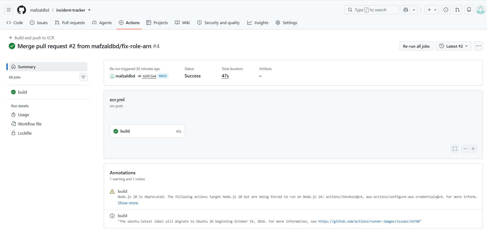
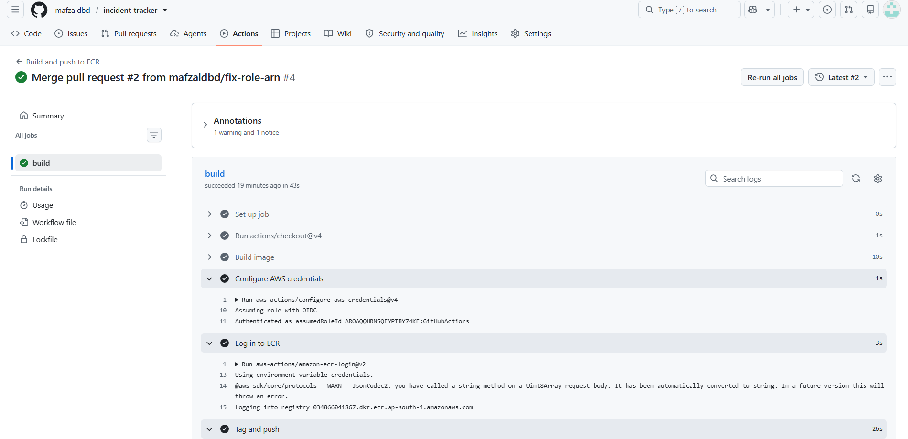
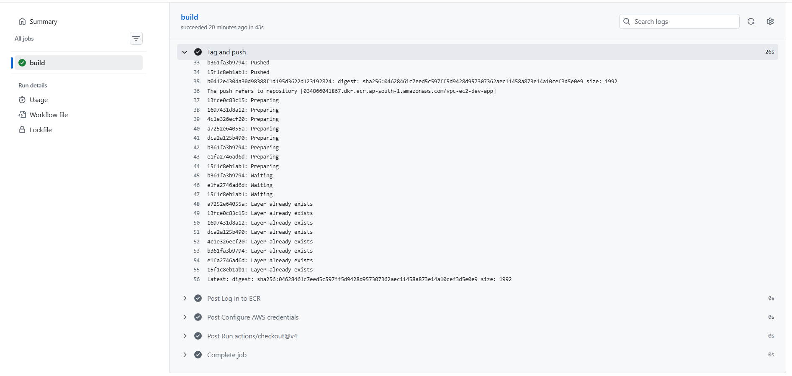
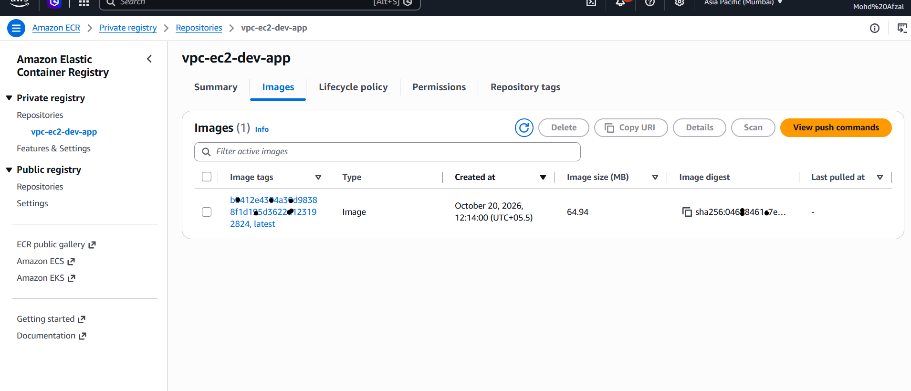

# Incident Tracker

A backend system for tracking server health and incidents, inspired by
enterprise ITSM tools (ServiceNow) I used daily in a cloud operations role.

## Live links

- **API Docs:** <https://incident-tracker-93cm.onrender.com/docs>
- **Dashboard (requires API key):** <https://incident-tracker-93cm.onrender.com/dashboard>

*Note: hosted on Render's free tier, so the first request after inactivity may take 30-60 seconds to wake up.*

## Why I built this

At Infosys, I manually monitored AWS infrastructure and logged incidents
in ServiceNow. This project automates that same workflow: it monitors
servers, auto-creates incidents when health checks fail, and tracks them
through resolution — the system I used to operate, now built by me.

## Features

- REST API (FastAPI) for managing servers, incidents, and incident logs
- PostgreSQL database (hosted on Neon) with relational schema
- Automated background health checks (APScheduler) that auto-create
  incidents on failure — no manual monitoring required
- API key authentication
- Simple dashboard for viewing live server/incident status
- Containerized with Docker for consistent, portable deployment
- CI/CD pipeline that builds the image and pushes it to Amazon ECR using GitHub OIDC (no stored AWS keys)

## Tech stack

Python, FastAPI, SQLAlchemy, PostgreSQL, APScheduler, Docker, GitHub Actions, Amazon ECR

## Running locally

1. Clone the repo, create a virtual environment, `pip install -r requirements.txt`
2. Create a `.env` file with `DATABASE_URL` and `API_KEY`
3. `python create_tables.py`
4. `uvicorn app.main:app --reload`
5. Visit `/docs` for the API, `/dashboard` for the UI

## Running with Docker

1. `docker build -t incident-tracker .`
2. `docker run -p 8000:8000 --env-file .env incident-tracker`

## CI/CD

The workflow in `.github/workflows/ecr.yml` runs on GitHub Actions:

- **On every pull request:** builds the Docker image, catching broken builds before merge.
- **On merge to `main`:** authenticates to AWS with GitHub OIDC, using a short-lived IAM role limited to a single ECR repository (no AWS keys stored in GitHub), then pushes the image tagged with the commit SHA and `latest`.

### Pull request: image build check

### Merge to main: authenticate and push to ECR

The run is shown in two screenshots, because the steps didn't fit in one.

### Result: image in Amazon ECR

## Related project

The AWS infrastructure for this kind of system (VPC, subnets, EC2, ECR, and a private RDS database), built with reusable Terraform modules, separate dev and prod environments, and a CI pipeline: [terraform-aws-vpc-ec2](https://github.com/mafzaldbd/terraform-aws-vpc-ec2)

## What I'd add next

- Run the container on EC2 connected to RDS, provisioned by the Terraform project above
- Real health checks (HTTP ping / server agent) instead of simulated data
- Prometheus and Grafana monitoring
- Extend the CI pipeline to run automated tests before the build step